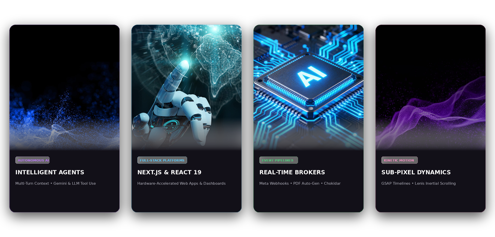

<div align="center">

# 🚀 WEBPULSE AUTOMATION — Next-Gen Web & AI Engineering
### Official Agency Platform for High-Velocity Web Apps & Autonomous AI Workflows

[](https://webpulseautomation.pages.dev/)
[](https://react.dev/)
[](https://www.typescriptlang.org/)
[](https://vitejs.dev/)
[](https://greensock.com/gsap/)
[](https://webpulseautomation.pages.dev/)
[](LICENSE)

<br/>

**[⚡ View Live Production Platform](https://webpulseautomation.pages.dev/)** &nbsp;•&nbsp; **[📦 GitHub Repository](https://github.com/labibfohayer/Webpulse-Automation-Website)**

<br/>



</div>

---

## 📌 Architectural Overview

**Webpulse Automation** is the official flagship agency web platform engineered for modern web development, business process automation, and autonomous AI agents. The platform translates complex engineering capabilities into an engaging, high-conversion visual showcase.

Engineered with **React 19**, **Vite 6**, and **Tailwind CSS v4**, the application achieves zero-delay page navigation, kinetic scroll dynamics powered by **GSAP 3** and **Lenis**, and real-time interactive quote builders.

---

## ⚡ Key Engineering Highlights

1. **Sub-Pixel Kinetic Scroll Dynamics:**
   - Continuous sub-frame physics using **Lenis** combined with **GSAP ScrollTrigger**.
   - Text split-reveals and staggered card entrance choreographies.

2. **Interactive Service & Architecture Showcase:**
   - Deep-dive interactive cards for Autonomous AI Workflows, Full-Stack Web Platforms, and Event Brokers.
   - Dynamic counter telemetry powered by countup.js.

3. **High-Performance Static Delivery:**
   - Bundled with Vite 6 with aggressive chunk splitting and tree-shaking for instantaneous global load times.

---

## 🛠️ Tech Stack & Production Architecture

| Layer | Technologies | Purpose |
| :--- | :--- | :--- |
| **Core Framework** | React 19, TypeScript, Vite 6 | Lightning-fast HMR and optimized production bundling |
| **Kinetic Motion** | GSAP 3.15, ScrollTrigger, Framer Motion 12 | Precision timeline animations and hardware-accelerated transforms |
| **Inertial Scrolling** | Lenis 1.3 Smooth Scroll | Unified smooth touch and mouse scroll physics |
| **Styling & Icons** | Tailwind CSS v4, Lucide React | Modern utility-first styling and vector typography |
| **Routing & Sliders** | React Router DOM v7, Swiper 14 | Fluid multi-route navigation and touch-enabled carousels |

---

## 🚀 Getting Started & Local Development

```bash
# Clone the repository
git clone https://github.com/labibfohayer/Webpulse-Automation-Website.git
cd Webpulse-Automation-Website

# Install dependencies
npm install

# Start Vite dev server
npm run dev
```

Open [http://localhost:5173](http://localhost:5173) to view the live development server.

---

## 📄 License
This project is open-source and distributed under the [MIT License](LICENSE).
